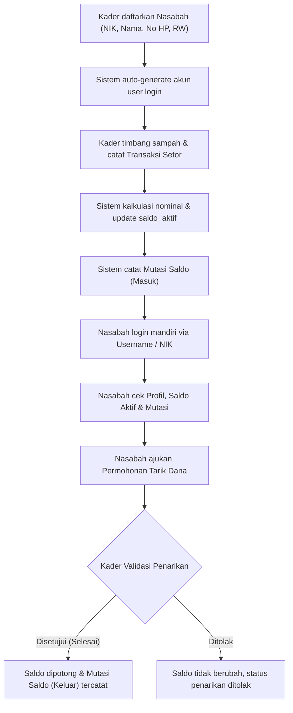
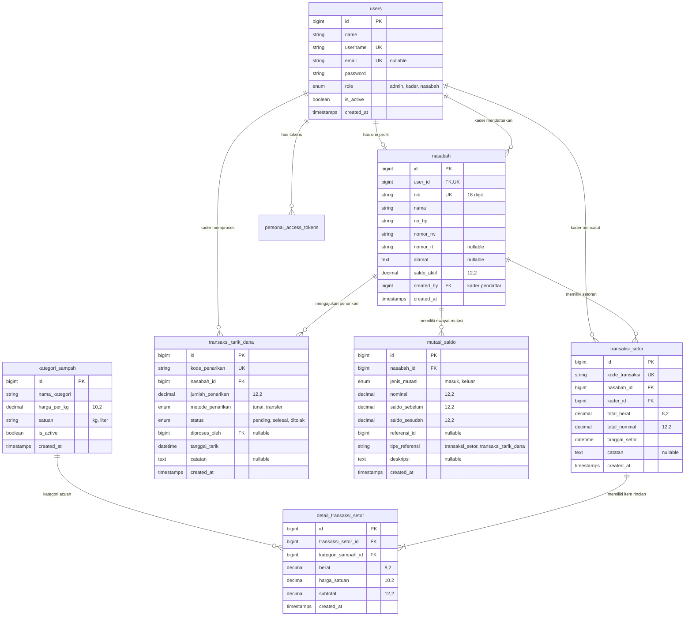

# ♻️ Sistem Informasi Bank Sampah Digital (Laravel 11 / 12 / 13 & MySQL 8.4)

Sistem Informasi Bank Sampah berbasis RESTful API dirancang untuk mendigitalkan seluruh alur pencatatan sampah daur ulang tingkat RW/RT, mulai dari pendaftaran nasabah oleh Kader, penimbangan dan perhitungan setoran sampah otomatis, pembukuan mutasi saldo secara atomik, hingga pengecekan profil, saldo, dan permohonan penarikan dana secara mandiri oleh Nasabah.

---

## 📌 1. Latar Belakang & Masalah (Problem Statement)

Pengelolaan bank sampah di lingkungan pemukiman (RT/RW) umumnya masih mengandalkan pencatatan berbasis buku manual (kertas). Praktik konvensional ini menimbulkan sejumlah kendala operasional:

1. **Human Error pada Perhitungan & Timbangan:** Perhitungan subtotal timbangan sampah berdasarkan harga per kategori rentan salah hitung saat penimbangan di lapangan.
2. **Risiko Kehilangan & Kerusakan Buku Fisik:** Catatan buku tabungan nasabah mudah hilang, basah, atau rusak, sehingga memicu sengketa pencatatan saldo.
3. **Ketiadaan Transparansi Saldo Real-Time:** Nasabah tidak dapat memantau saldo aktif atau memeriksa riwayat setoran secara mandiri tanpa harus mendatangi kader bank sampah.
4. **Alur Penarikan Dana yang Tidak Terdokumentasi:** Penarikan uang tunai sering kali tidak diimbangi dengan mutasi keluar yang tercatat seketika, membuka celah selisih kas pengurus.
5. **Lambatnya Rekapitulasi Kas RW:** Kader bank sampah membutuhkan waktu cukup lama untuk menghitung kas yang dapat diterima berdasarkan volume sampah terpilah.

**Solusi Digital:**
Aplikasi ini mentransformasikan alur kerja tersebut menjadi sistem digital yang aman, transparan, dan terintegrasi menggunakan transaksi database atomik (*ACID*) dan otentikasi aman berbasis token (*Laravel Sanctum*).

---

## 🎯 2. Ruang Lingkup MVP (Minimum Viable Product)

### A. User Story Nasabah
> *"Sebagai nasabah, saya ingin melakukan pengecekan saldo secara mandiri agar saya dapat menarik dana sesuai dengan saldo yang saya miliki."*

### B. Acceptance Criteria Profil Nasabah
Setiap profil nasabah yang terdaftar wajib memiliki:
- **NIK:** Tepat 16 digit angka, bernilai unik (`unique`).
- **Nama Lengkap:** String teks identitas resmi nasabah.
- **Nomor HP:** String nomor telepon aktif untuk komunikasi.
- **Nomor RW:** Maksimal 5 karakter (contoh: `05`, `06`).
- **Nomor RT:** Opsional, identitas rukun tetangga.
- **Alamat Domisili:** Keterangan alamat tempat tinggal warga.

### C. User Flow Inti


---

## 👥 3. Struktur Tim & Pembagian Peran

| Peran | Tanggung Jawab Utama |
|---|---|
| **Product Owner / Project Lead** | Menetapkan spesifikasi kebutuhan bisnis, aturan operasional bank sampah RW, dan alur otentikasi. |
| **Backend Engineer** | Mengembangkan arsitektur database, REST API, implementasi database transaction, locking concurrency, dan middleware otorisasi. |
| **QA / Test Engineer** | Merancang skenario unit/feature testing otomatis (PHPUnit) dan memvalidasi integritas relasi data fiktif. |
| **Kader Bank Sampah (Operator)** | Pendaftaran nasabah baru di pos RW, penimbangan sampah, pencatatan transaksi setoran, dan verifikasi/penyerahan dana penarikan. |
| **Nasabah (Warga RT/RW)** | Menyetor sampah daur ulang, mengecek mutasi dan saldo mandiri via gawai, serta mengajukan permohonan penarikan dana. |

---

## 🗄️ 4. Skema Database & ERD (Entity Relationship Diagram)

### Diagram ERD (Mermaid)


---

## 🛠️ 5. Versi & Stack Teknologi

- **Bahasa Pemrograman:** PHP 8.3.x (`php-8.3.30-Win32-vs16-x64`)
- **Web Framework:** Laravel Framework 13.x (kompatibel Laravel 11/12/13)
- **Database Engine:** MySQL 8.4 LTS (`mysql-8.4.3-winx64`, InnoDB, UTF8mb4)
- **Otentikasi API:** Laravel Sanctum 4.x (Personal Access Tokens / Bearer Token)
- **Otomasi Pengujian:** PHPUnit 12.x (In-memory SQLite untuk pengujian cepat & terisolasi)
- **Code Linter & Formatter:** Laravel Pint 1.x (Standar PSR-12 / Laravel Code Style)
- **Lingkungan Lokal:** Laragon / Windows PowerShell

---

## 🚀 6. Panduan Setup, Migrate, Seed, & Hasil Cek

### A. Prasyarat Sistem
Pastikan PHP 8.3, Composer, dan MySQL 8.4 telah terpasang dan berjalan di lingkungan lokal:
```powershell
php -v
composer -V
```

### B. Konfigurasi Lingkungan (`.env`)
Salin file konfigurasi lingkungan dan sesuaikan kredensial basis data:
```powershell
cp .env.example .env
php artisan key:generate
```

Pastikan variabel database pada file `.env` terkonfigurasi sebagai berikut:
```ini
DB_CONNECTION=mysql
DB_HOST=127.0.0.1
DB_PORT=3306
DB_DATABASE=banksampah
DB_USERNAME=root
DB_PASSWORD=
```

### C. Eksekusi Migrasi Database
Jalankan migrasi seluruh tabel:
```powershell
php artisan migrate
```

### D. Eksekusi Seeder Data Fiktif
Jalankan seeder untuk mengisi data master kategori, akun pengurus/nasabah, dan riwayat transaksi fiktif:
```powershell
php artisan db:seed
```

### E. Verifikasi Hasil Seeding (`db:check-stats`)
Proyek ini dilengkapi artisan command khusus untuk memverifikasi jumlah data, integritas relasi, dan contoh record secara instan:
```powershell
php artisan db:check-stats
```

#### Laporan Verifikasi: Expected vs Actual
| Model | Expected | Actual | Status | Keterangan |
|---|:---:|:---:|:---:|---|
| `User` | **13** | **13** | **MATCH** | 1 Admin, 2 Kader, 10 Nasabah |
| `Nasabah` | **10** | **10** | **MATCH** | Profil 10 nasabah terhubung dengan akun user |
| `KategoriSampah` | **8** | **8** | **MATCH** | 8 kategori sampah daur ulang |
| `TransaksiSetor` | **6** | **6** | **MATCH** | 6 transaksi setoran sampah |
| `DetailTransaksiSetor`| **11** | **11** | **MATCH** | 11 baris rincian item timbangan |
| `TransaksiTarikDana` | **4** | **4** | **MATCH** | 2 Selesai, 1 Pending, 1 Ditolak |
| `MutasiSaldo` | **8** | **8** | **MATCH** | 6 mutasi Masuk + 2 mutasi Keluar |

#### Laporan Integritas Relasi
- Relasi `User` $\rightarrow$ `Nasabah`: **10/10 Valid (OK)**
- Relasi `Nasabah` $\rightarrow$ `User`: **10/10 Valid (OK)**
- Relasi `Nasabah` $\rightarrow$ `Kader Pendaftar`: **10/10 Valid (OK)**
- Relasi `TransaksiSetor` $\rightarrow$ `Nasabah`: **6/6 Valid (OK)**
- Relasi `TransaksiSetor` $\rightarrow$ `Kader`: **6/6 Valid (OK)**
- Relasi `TransaksiSetor` $\rightarrow$ `Details`: **6/6 Valid (OK)**
- Relasi `DetailTransaksiSetor` $\rightarrow$ `KategoriSampah`: **11/11 Valid (OK)**
- Relasi `TransaksiTarikDana` $\rightarrow$ `Nasabah`: **4/4 Valid (OK)**
- Relasi `MutasiSaldo` $\rightarrow$ `Nasabah`: **8/8 Valid (OK)**

### F. Menjalankan Automated Feature Test
Jalankan seluruh pengujian otomatis untuk memvalidasi alur otentikasi, hak akses, setoran, penarikan, dan mutasi saldo:
```powershell
php artisan test
```
*Hasil Uji: 25 test cases lulus (25 passed, 125 assertions).*

---

## 🔐 7. Kebijakan Akun & Bukti Login

### A. Kebijakan Peran (*Role Policy*)
1. **`admin`**: Memiliki hak akses monitoring menyeluruh sistem, master data, dan audit transaksi.
2. **`kader`**: Operator pos bank sampah. Berhak mendaftarkan nasabah baru, menginput transaksi setoran sampah, melihat rekap kas, dan menyetujui/menolak permohonan penarikan dana.
3. **`nasabah`**: Warga pemilik tabungan. Hanya berhak mengakses profil miliknya sendiri, melihat saldo aktif, mengecek riwayat mutasi, dan mengajukan penarikan dana.

### B. Kebijakan Pembuatan Akun Nasabah Otomatis (*Auto-Generate*)
Saat Kader mendaftarkan data profil warga:
- **Username:** Dibuat otomatis dengan format `nsb_<nama_depan>_<4_digit_terakhir_nik>` (dijamin unik).
- **Initial Password:** Dibuat otomatis menggunakan **6 digit terakhir NIK** warga agar mudah disosialisasikan dan diingat.
- Password langsung dienkripsi menggunakan algoritma `bcrypt` (`Hash::make`).

### C. Daftar Akun Dummy untuk Uji Coba

Semua akun dummy menggunakan password default: `password` *(atau 6 digit terakhir NIK untuk akun nasabah)*.

| Peran | Username | NIK | Nama | Saldo Aktif | Keterangan |
|---|---|---|---|---|---|
| **Admin** | `admin` | - | Administrator Bank Sampah | - | Akses master |
| **Kader** | `kader_siti` | - | Siti Aminah | - | Kader Pos RW 05 |
| **Kader** | `kader_budi` | - | Budi Santoso | - | Kader Pos RW 06 |
| **Nasabah** | `nasabah_dewi` | `3201015502900001` | Dewi Lestari | Rp 51.000 | 2 setoran, 1 tarik tunai selesai |
| **Nasabah** | `nasabah_agus` | `3201011208880002` | Agus Pratama | Rp 58.000 | 1 setoran, 1 tarik pending Rp 20.000 |
| **Nasabah** | `nasabah_rina` | `3201016711950003` | Rina Wulandari | Rp 0 | Nasabah baru terdaftar |
| **Nasabah** | `nasabah_bambang` | `3201011005850004` | Bambang Pamungkas | Rp 16.000 | 1 setoran, 1 tarik transfer selesai |
| **Nasabah** | `nasabah_eko` | `3201012304890006` | Eko Prasetyo | Rp 68.000 | 1 setoran, 1 tarik ditolak kas habis |
| **Nasabah** | `nasabah_maya` | `3201015607940007` | Maya Indah | Rp 48.000 | 1 setoran daur ulang |

---

### D. Bukti Login API (Request & Response)

#### 1. Bukti Login Kader (via Username)
**Request:**
```http
POST /api/auth/login
Content-Type: application/json

{
  "login": "kader_siti",
  "password": "password"
}
```
**Response (HTTP 200 OK):**
```json
{
  "success": true,
  "message": "Selamat datang, Siti Aminah!",
  "data": {
    "token": "1|g8Dkd73kLmQ0...",
    "token_type": "Bearer",
    "user": {
      "id": 2,
      "name": "Siti Aminah",
      "username": "kader_siti",
      "email": "kader.siti@banksampah.test",
      "role": "kader",
      "nasabah": null
    }
  }
}
```

#### 2. Bukti Login Nasabah (Mandiri via 16 Digit NIK)
**Request:**
```http
POST /api/auth/login
Content-Type: application/json

{
  "login": "3201015502900001",
  "password": "password"
}
```
**Response (HTTP 200 OK):**
```json
{
  "success": true,
  "message": "Selamat datang, Dewi Lestari!",
  "data": {
    "token": "2|r9KjL30xPa8...",
    "token_type": "Bearer",
    "user": {
      "id": 4,
      "name": "Dewi Lestari",
      "username": "nasabah_dewi",
      "email": "dewi@banksampah.test",
      "role": "nasabah",
      "nasabah": {
        "id": 1,
        "nik": "3201015502900001",
        "nama": "Dewi Lestari",
        "no_hp": "081234567801",
        "nomor_rw": "05",
        "nomor_rt": "02",
        "alamat": "Jl. Melati No. 12 RT 02 RW 05",
        "saldo_aktif": 51000
      }
    }
  }
}
```

---

## 📡 8. Rangkuman Daftar Endpoint API

### Otentikasi & Publik
- `POST /api/auth/login` : Login via Username / Email / NIK
- `GET /api/kategori-sampah` : Daftar master kategori sampah & harga acuan
- `GET /api/auth/me` : Informasi identitas user yang sedang login `[auth:sanctum]`
- `POST /api/auth/logout` : Revoke token akses `[auth:sanctum]`

### Khusus Kader (`role: kader,admin`)
- `POST /api/kader/nasabah` : Mendaftarkan nasabah & auto-generate user login
- `GET /api/kader/nasabah` : List nasabah, pagination & filter RW/RT/nama
- `GET /api/kader/nasabah/{id}` : Detail nasabah
- `POST /api/kader/setor` : Input transaksi setoran sampah (atomik saldo & mutasi)
- `GET /api/kader/setor` : Riwayat seluruh transaksi setoran sampah
- `GET /api/kader/setor/{id}` : Detail transaksi setoran & rincian timbangan
- `GET /api/kader/penarikan` : Daftar permohonan penarikan dana nasabah
- `GET /api/kader/penarikan/{id}` : Detail penarikan dana
- `POST /api/kader/penarikan/{id}/validasi` : Setujui (`selesai`) atau tolak (`ditolak`) penarikan

### Khusus Nasabah Mandiri (`role: nasabah`)
- `GET /api/nasabah/profil` : Cek profil nasabah (NIK, Nama, No HP, RW/RT)
- `GET /api/nasabah/saldo` : Cek saldo aktif mandiri secara real-time
- `GET /api/nasabah/mutasi` : Riwayat mutasi masuk/keluar saldo
- `GET /api/nasabah/setor` : Riwayat setoran sampah nasabah
- `GET /api/nasabah/penarikan` : Riwayat permohonan penarikan dana nasabah
- `POST /api/nasabah/penarikan` : Mengajukan permohonan penarikan dana baru

---

## 📄 Lisensi
Sistem Bank Sampah ini didistribusikan di bawah lisensi terbuka [MIT License](LICENSE).
